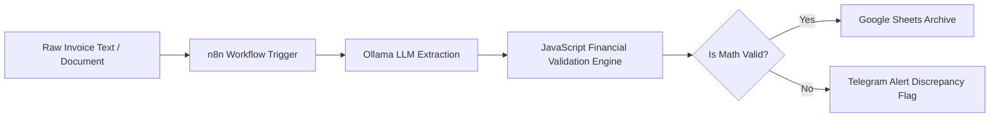

#  Smart Invoice Auditor Pipeline (Local & Privacy-First)

An enterprise-ready **Intelligent Document Processing (IDP)** pipeline built with **n8n** and **Ollama (Local LLM)**. It autonomously parses unstructured financial documents, enforces mathematical integrity checks via a custom validation engine, and automates downstream actions (Google Sheets recording & Telegram alerts).

---

##  Business Problem & Solution

* **The Problem:** Finance teams spend hundreds of hours manually keying invoice data into accounting sheets. Manual validation is prone to errors, overlooking arithmetic discrepancies or fraudulent charges.
* **The Solution:** A zero-cost, privacy-first pipeline that processes raw documents locally using open-source models, validates itemized line sums against stated subtotals and taxes, and guarantees that only verified data enters corporate spreadsheets.

---

##  System Architecture

 Key Features
Local & Privacy-Preserving: Powered by local Ollama models (qwen2.5:7b / llama3.2) to safeguard confidential financial records from third-party APIs.

Deterministic Validation Engine: Custom JavaScript node verifies:

Item total = Quantity × Unit Price

Subtotal = Sum of Item Totals

Grand Total = Subtotal + Tax

Human-in-the-Loop Routing: Automatically routes flagged invoices with precise discrepancy logs to a designated operations channel (Telegram/Slack).

Structured Archival: Appends sanitized, validated invoice metadata directly into Google Sheets.

 Quickstart Guide
1. Prerequisites
Docker Desktop

Ollama installed locally

2. Pull the Local Model

2. Pull the Local Model
ollama run qwen2.5:7b
3. Import the Workflow
In n8n, go to Workflows > Import from File.

Select Smart-Invoice-Auditor-Pipeline.json.

Configure your Google Service Account credentials and Ollama Base URL ([http://host.docker.internal:11434](http://host.docker.internal:11434)).

Execute and test!
